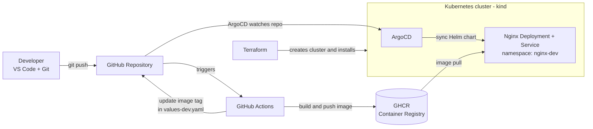
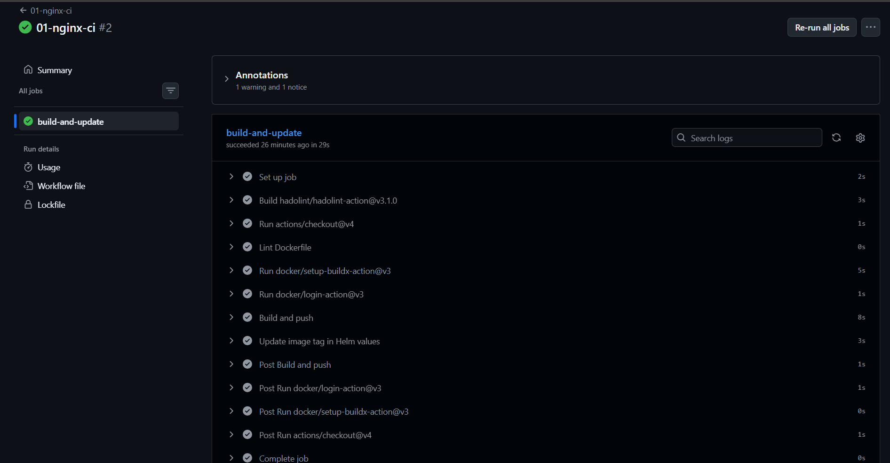
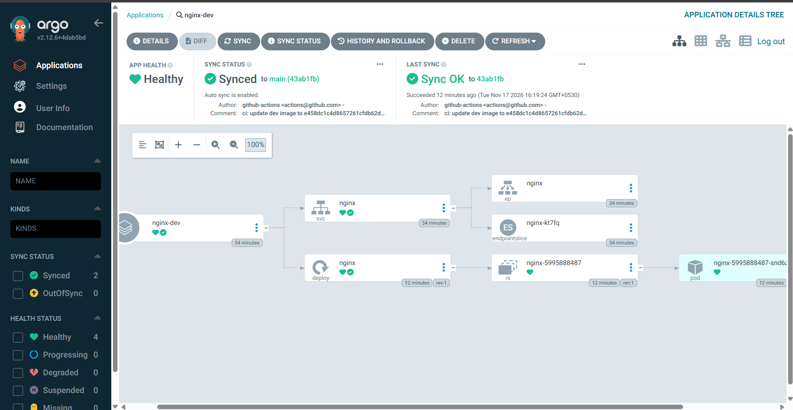
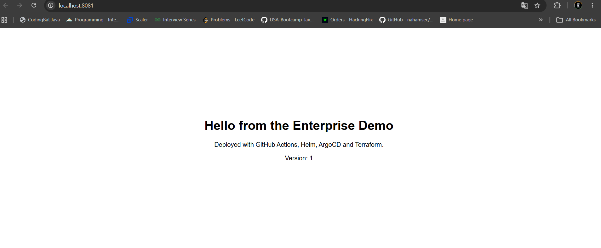
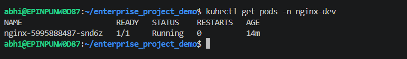

# Enterprise Project Demo


A hands-on DevOps portfolio that mimics a small enterprise delivery platform. Infrastructure is provisioned as code with **Terraform**, applications are packaged with **Docker** and **Helm**, built and published by **GitHub Actions**, and deployed to **Kubernetes** using **GitOps with ArgoCD**.

**Author:** Abhinandan Gayaki ([@abhi0xdev](https://github.com/abhi0xdev))

---

## Table of contents

1. [Projects](#projects)
2. [Architecture](#architecture)
3. [CI/CD flow](#cicd-flow)
4. [Tech stack](#tech-stack)
5. [Repository structure](#repository-structure)
6. [Getting started](#getting-started)
7. [Demo walkthrough](#demo-walkthrough)
8. [Design decisions](#design-decisions)
9. [Lessons learned](#lessons-learned)
10. [Roadmap](#roadmap)

---

## Projects

| 00 | Platform | Terraform modules (kind-cluster, helm-addons, namespaces), dynamic config | Done |
| 01 | Nginx GitOps | Multi-stage non-root image, Trivy/Snyk/StackHawk, 3 environments, approvals | Done |
| 02 | Progressive delivery | Argo Rollouts canary and blue-green | In progress |

---

## Architecture



**Key idea:** nobody runs `kubectl apply` for application changes. Git is the single source of truth, and ArgoCD continuously makes the cluster match it.

---

## CI/CD flow

1. A developer changes the app (`01-nginx-gitops/app/`) and pushes to `main`.
2. **GitHub Actions** lints the Dockerfile (hadolint), builds the image, and pushes it to GHCR tagged with the commit SHA.
3. The pipeline updates `image.tag` in `values-dev.yaml` and commits it back to the repo.
4. **ArgoCD** detects the Git change, renders the Helm chart, and syncs the cluster.
5. Kubernetes performs a rolling update with the new image.

Additional workflows:

- **Pull request checks:** `helm lint` and manifest validation with kubeconform.
- **Terraform checks:** `terraform fmt`, `init`, and `validate` on pull requests.

Workflows trigger only on `app/**` changes. The pipeline's own commit to `values-dev.yaml` therefore does not start another run, which avoids an infinite loop.

---

## Tech stack

| Area | Tool |
|------|------|
| Infrastructure as Code | Terraform (kind and Helm providers) |
| Container runtime and cluster | Docker, kind (Kubernetes in Docker) |
| Packaging | Helm chart |
| CI | GitHub Actions |
| Registry | GitHub Container Registry (GHCR) |
| CD / GitOps | ArgoCD (automated sync, self-heal, prune) |
| Web server | Nginx (alpine) |
| Development | WSL2 (Ubuntu), VS Code IDE, GitHub CLI |

---

## Repository structure

```
enterprise_project_demo/
├── README.md
├── .github/workflows/          # CI/CD pipelines (path-filtered per project)
├── shared/                     # scripts and docs shared across projects
├── 00-platform/
│   └── terraform/              # kind cluster + ArgoCD
└── 01-nginx-gitops/
    ├── app/                    # Dockerfile and static site
    ├── charts/nginx-app/       # Helm chart (values.yaml, values-dev.yaml)
    └── argocd/                 # ArgoCD Application manifest
```

---

## Getting started

### Prerequisites

Docker, kind, kubectl, Helm, Terraform, and GitHub CLI (`gh`), installed in WSL2 Ubuntu or Linux. Docker needs at least 4 GB of RAM.

### 1. Create the platform

```bash
cd 00-platform/terraform
terraform init
terraform apply
```

This creates a 2-node kind cluster and installs ArgoCD in the `argocd` namespace.

### 2. Deploy the application through ArgoCD

```bash
kubectl apply -f 01-nginx-gitops/argocd/application-dev.yaml
kubectl get applications -n argocd
```

### 3. Access the tools

ArgoCD UI:

```bash
kubectl -n argocd get secret argocd-initial-admin-secret -o jsonpath="{.data.password}" | base64 -d; echo
kubectl port-forward svc/argocd-server -n argocd 8080:443
```

Open https://localhost:8080 (user: `admin`). Accept the self-signed certificate warning.

Nginx app:

```bash
kubectl port-forward svc/nginx -n nginx-dev 8081:80
```

Open http://localhost:8081.

### Cleanup

```bash
cd 00-platform/terraform
terraform destroy
```

---

## Demo walkthrough

1. Edit `01-nginx-gitops/app/index.html` (for example, change "Version: 1" to "Version: 2") and push to `main`.
2. Watch the pipeline with `gh run watch`.
3. ArgoCD shows the application go **OutOfSync**, then **Synced**.
4. Refresh the nginx page to see the new version.
5. **Self-heal test:** run `kubectl scale deploy nginx -n nginx-dev --replicas=5`. ArgoCD reverts it to the value in Git.

---

### Screenshots

**GitHub Actions pipeline**



**ArgoCD showing the app Synced and Healthy**



**Running nginx app**



**Pods running in the cluster**



---

## Design decisions

- **Monorepo with numbered projects:** one link shows all work, and each project stays self-contained with its own README.
- **GitOps over push-based deployment:** the cluster never needs to be reachable from CI. ArgoCD pulls changes, which is more secure and gives automatic drift correction.
- **Helm over raw manifests:** one chart with per-environment values files (`values-dev.yaml`) makes adding `prod` straightforward.
- **Image tag = commit SHA:** every deployment is traceable and rollbacks are a Git revert.
- **Terraform applied locally:** GitHub-hosted runners cannot reach a local kind cluster, so CI runs only format and validate checks. A cloud cluster would allow plan and apply in CI.
- **Local kind cluster:** zero cost and fast to rebuild, while using the same Kubernetes APIs as a managed cluster.

---

## Lessons learned

Real issues hit during the build and how they were resolved:

| Problem | Cause | Fix |
|---------|-------|-----|
| `git push` failed with `src refspec main does not match any` | Local branch was `master` | `git branch -M main` and set `init.defaultBranch main` |
| `helm lint` failed with `did not find expected key` | Indentation broken in the template by editor auto-formatting | Rewrote the file and disabled format-on-save for Helm templates |
| ArgoCD sync failed with `unable to parse quantity's suffix` | Invalid CPU/memory unit in Helm values. `helm lint` cannot catch this because it does not know Kubernetes units | Used valid quantities (`50m`, `64Mi`) and validated with `kubectl apply --dry-run=server` |
| Pods in `ImagePullBackOff` | GHCR package private by default | Set the package visibility to public |
| Browser warning on ArgoCD UI | Self-signed certificate on localhost | Expected for local demo, proceed past the warning |

---
